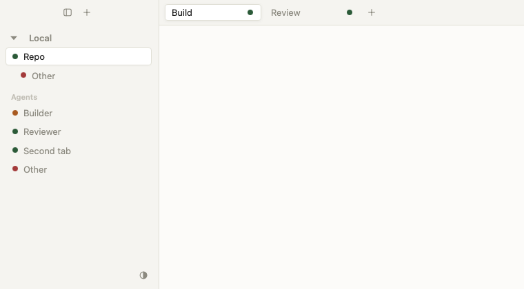
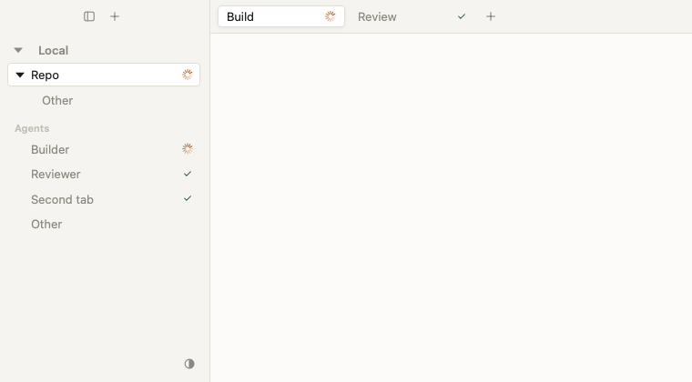
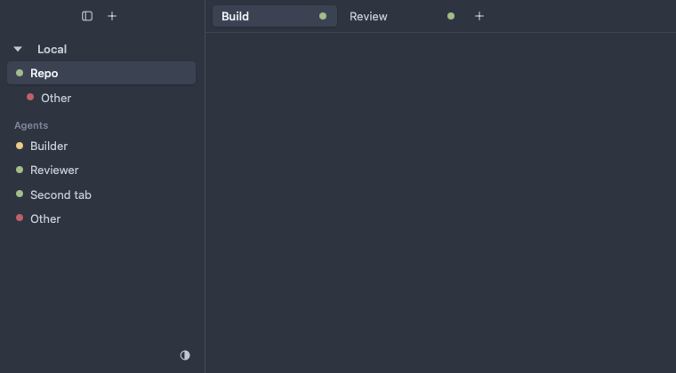
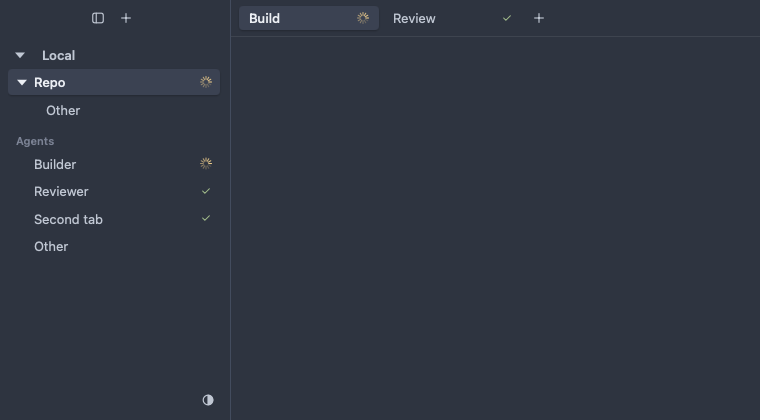

# Activity and deliberate visits

Workspace and top-tab rows have one trailing status slot:

- An actual agent working in that row's scope shows a spinner. Work takes
  precedence over completion, even if the backend's aggregate says done.
- Otherwise, a current authoritative completion token not acknowledged by this
  window shows a checkmark.
- Otherwise the slot is empty. Blocked/input waits, unknown status and offline
  transport are not work or successful completion. Existing attention notices
  and connection tooltips remain independent.

The indicators are passive: no action, keyboard stop or pointer interception.
The row's accessibility description conveys its status. Repository disclosure
arrows remain visible independently of activity. Machine headers stay where they
were. The sidebar has no separate Agents roster. Top tabs keep their existing single 12-DIP slot:
hovering a tab replaces its status with the existing close control, including
its original close hit target. Native window buttons and other icons are unchanged.

## Authoritative tokens, local acknowledgments

The endpoint pairs completion sequences with the snapshot's boot and revision.
Only that paired projection supplies completion tokens; backend status changes,
notifications or inferred run IDs never manufacture them. Each machine keeps a
small window-local pane-to-sequence acknowledgment map, reset for another boot
or a removed/retargeted machine. A valid same-boot reconnect preserves history;
authoritative deletion/replacement prunes stale acknowledgments.

At the first trusted attachment, tokens of already-seen idle agents are seeded
as acknowledged; backend done remains unvisited. A missing projection is **not**
an authoritative empty projection, and does not erase same-boot history.

Deliberate Workspace activation acknowledges currently known tokens across that
Workspace's tabs; tab activation acknowledges its tab; Agent/pane activation
acknowledges that pane. Directional pane navigation acknowledges only the
changed destination returned by the successful RPC, without waiting for another
snapshot. Legacy/empty or malformed direction results acknowledge nothing.
Reactivating the selected item counts too. Tokens are
captured at intent and acknowledged only after successful navigation. Deferred
remote navigation never acknowledges tokens arriving after the click, or on
failure. A newer completion sequence remains new even if an older visit finishes
later. This does not change the backend's shared seen state.

Rendering, selected/focused state, restored sessions, hovering, folding, resizing
and reconnecting do not acknowledge completions. Geometry/refocus requests are
not deliberate visits.

### Older endpoints

Without a trusted completion projection, actual working agents can still show
progress, but this client cannot safely offer completion checks or acknowledge
completion sequences. If a projection is unavailable when navigation finishes,
that visit conservatively leaves tokens unacknowledged; existing same-boot
acknowledgments are retained. It deliberately does not fall back to a local run ledger
or interpret idle/blocked/disconnection as completion.

## Headless visual comparison

The same compact fixture renders the sidebar and top tabs without opening an
application window. The before images use the renderer at main
`423077610869294a48236bc0e6de62118cf03b26`; after images show working/completed/attention
rows and independent repository disclosure.

| Theme | Before                                                  | After                                                 |
| ----- | ------------------------------------------------------- | ----------------------------------------------------- |
| Paper |  |  |
| Nord  |    |    |

Capture with `THEME_SHOTS=/tmp/activity-shots go test ./internal/app -run '^TestActivityVisuals$' -count=1`.
The ordinary suite also checks built-in themes at 1x/2x and uses the headless
clock to verify animation, stopping and stable slot geometry.
